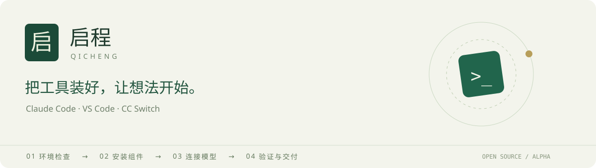
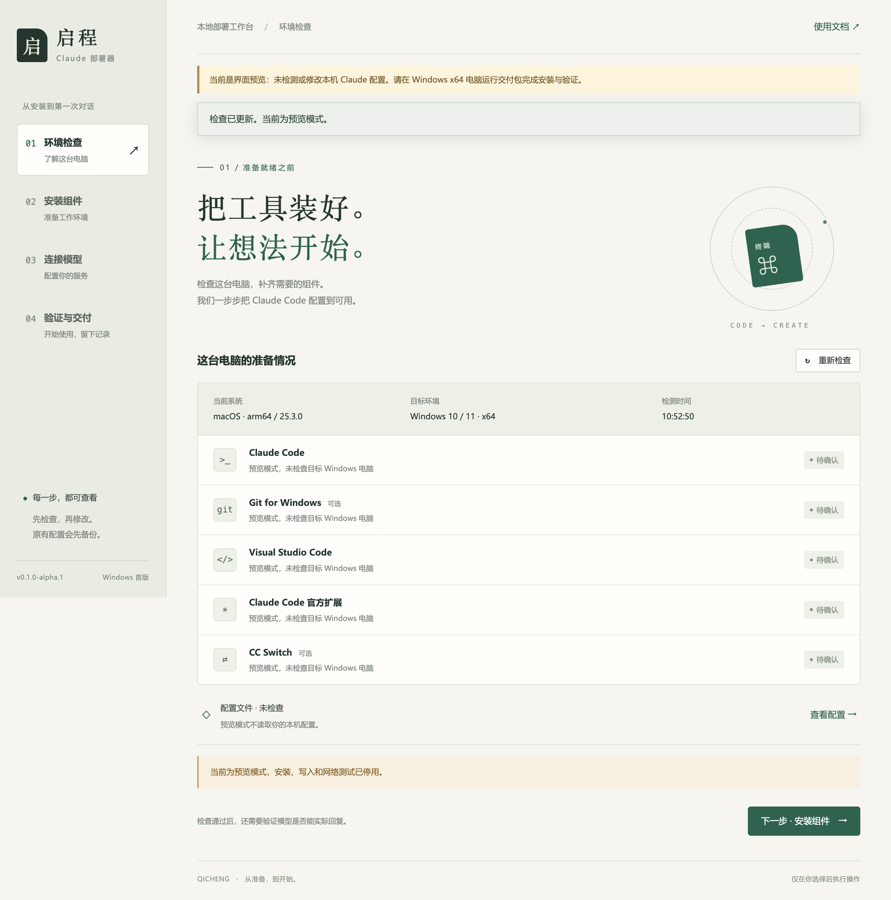
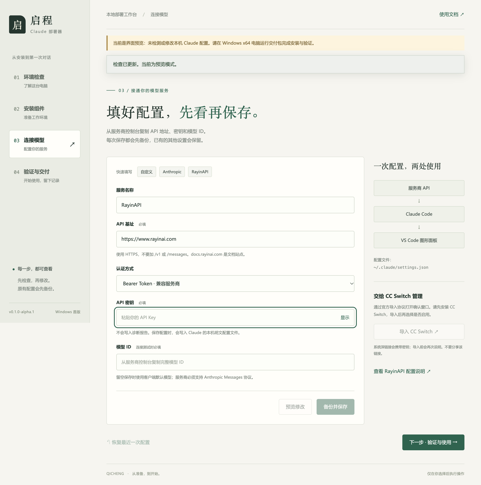
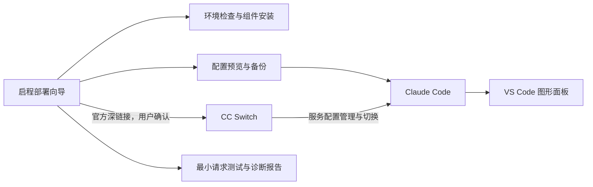

<div align="center">



# 启程 · Qicheng

**把工具装好，让想法开始。**

面向 Windows 的 Claude Code 中文图形部署向导，连接 **Claude Code · VS Code · CC Switch**。

A transparent Windows setup companion for Claude Code — inspect, install, configure, and verify.

[](LICENSE)
[](https://github.com/THEBLUEGHOSTSSSS/qicheng-claude-deployer/releases)


[下载试用包](https://github.com/THEBLUEGHOSTSSSS/qicheng-claude-deployer/releases) · [快速上手](docs/getting-started.md) · [报告问题](https://github.com/THEBLUEGHOSTSSSS/qicheng-claude-deployer/issues/new/choose) · [参与贡献](CONTRIBUTING.md)

</div>

---

## “已经安装了，为什么还是跑不起来？”

装好客户端只是开始。缺了组件、填错 API 地址、认证方式不匹配、配置被其他工具覆盖，都会让第一次使用卡在半路。

**启程把这些零散步骤放进一个中文桌面向导：先看清环境，再安装组件；修改配置前先预览，保存前先备份；最后验证连接，并把结果带走。**

适合第一次使用 Claude Code 的老师、研究者、学生，也适合需要帮同事准备开发环境的人。你可以按步骤操作，也可以直接跳到配置或诊断页面。

> **当前为 Alpha 开发试用版。** 核心行为测试、macOS 上的真实 Electron 界面检查和 Windows ZIP 构建已完成；Windows 真机安装、CC Switch 实际导入、真实账户与工具调用仍待验证。详见[验证范围](docs/validation.md)。

## 界面一览

下面是实际运行的桌面界面，截图处于 **macOS 预览模式**，没有安装软件或修改本机 Claude 配置。



<details>
<summary><strong>展开查看：连接模型与 CC Switch 导入</strong></summary>



</details>

## 四步，走到可以开始的位置

| 步骤 | 你要做什么 | 启程提供什么 |
| --- | --- | --- |
| **01 · 环境检查** | 看清这台电脑的准备情况 | 检测系统、Claude Code、Git、VS Code、扩展和 CC Switch，区分已检测、待安装与待确认 |
| **02 · 安装组件** | 选择需要的工具 | 固定官方分发入口、逐项确认、安装后重新检测；CC Switch 安装包校验大小与 SHA-256 |
| **03 · 连接模型** | 填写自己的服务配置 | 自定义 / Anthropic / RayinAPI 模板，修改预览、原配置备份、冲突检查、CC Switch 导入 |
| **04 · 验证与交付** | 做一次最小测试并开始使用 | 固定短文本请求、可理解的错误提示、VS Code 入口、脱敏诊断报告 |

### 为什么值得一试

- **少翻几份文档。** 安装入口、API 配置、图形客户端和诊断放在同一个流程里。
- **每次修改都能看清。** 先预览受影响字段，保存时保留其他设置；发现已有配置损坏或认证冲突时停止覆盖。
- **留一条回头路。** 保存原文件字节并提供恢复入口；如果后来又改过配置，自动恢复会停止，避免覆盖后续工作。
- **接入你已有的工具。** 使用 VS Code 官方 Claude 扩展作为图形对话入口，通过 CC Switch 官方深链接交接服务配置。
- **失败也有可读的结果。** 区分认证、权限、地址、限流、网络和响应格式问题；HTTP 200 不会直接被当作模型可用。
- **方便协作排查。** 导出的 JSON 使用字段白名单，不包含 API 密钥、配置正文或聊天内容。

## 下载与开始

### 普通使用者

1. 前往 [Releases](https://github.com/THEBLUEGHOSTSSSS/qicheng-claude-deployer/releases)，下载带有 `Windows-x64-Portable.zip` 的试用包。
2. **完整解压**，双击 `Qicheng Deployer.exe`。不要在 ZIP 内运行，也不要只复制 exe。
3. 按四步向导操作。安装外部组件需要联网；密钥和模型 ID 请从你自己的服务商控制台获取。

目标电脑无需预装 Node.js 或 Python，ZIP 自带桌面运行时。使用官方账户登录时，可以跳过 API 配置，在 VS Code 内完成官方登录。

| 环境 | 当前范围 |
| --- | --- |
| Windows 10 1809+ / Windows 11，x64 | 首版部署目标；待真机验收 |
| macOS / Linux | 界面预览；不启用安装、配置写入或模型请求 |
| ARM64 | 尚未验证，不作为当前支持目标 |
| 完全离线安装 | 未提供；外部组件下载仍需要网络 |
| Claude Desktop | 未覆盖其专用部署流程；当前图形入口是 VS Code 扩展 |

试用包没有单独的发布者代码签名。遇到系统拦截请先核对来源和校验文件，不要关闭系统保护。[完整操作说明 →](docs/getting-started.md)

### 开发者：本地预览

需要 Node.js 22.12+、npm；结构检查与交付打包需要 Python 3。

```bash
git clone https://github.com/THEBLUEGHOSTSSSS/qicheng-claude-deployer.git
cd qicheng-claude-deployer
npm ci
npm run preview
```

也可以直接打开 `src/renderer/index.html` 查看浏览器示例。没有桌面 bridge 时，实际安装、保存和测试按钮会停用。

Windows 上运行 `npm start` 会启用真实环境检测。安装、写配置和发送测试仍需用户主动操作与原生确认。

## 与 CC Switch 怎样配合？



启程负责首次部署与诊断，CC Switch 负责后续服务商管理。当前集成使用官方发布包和 `ccswitch://v1/import`，不直接修改 CC Switch 的内部数据库，也不自动接管其代理。

**请注意两个细节：**

- 导入请求会打开 CC Switch 确认窗口，用户仍需确认导入并选择是否启用；部署器无法据此确认导入成功。深链接携带密钥，不应复制分享。
- 锁定的 CC Switch v4.0.22 导入路径使用 Bearer Token。官方 API Key 模式请直接保存配置，或在 CC Switch 内使用官方预设；启程会阻止混用两种认证字段。

CC Switch 并非此项目的内嵌插件，当前也没有任意第三方插件加载系统。新组件接入需要补充明确的检测、安装和验证逻辑。[集成细节 →](docs/integration.md)

## 对配置与密钥的处理

| 机制 | 当前实现 |
| --- | --- |
| 修改范围 | 用户的 `~/.claude/settings.json`；合并管理字段，保留无关设置 |
| 备份与恢复 | 保存原字节，校验摘要；原子替换；恢复前检查后续修改 |
| 异常处理 | 坏 JSON、链接路径、认证助手、自定义配置目录等情况停止自动写入 |
| 界面隔离 | Electron context isolation + sandbox；renderer 无 Node 访问，IPC 有动作与来源检查 |
| 网络测试 | HTTPS、固定短文本、最多生成 16 token、超时与响应大小限制、不自动重试 |
| 日志与报告 | 不记录表单密钥或模型响应正文；报告采用字段白名单 |

**密钥会按 Claude Code 的配置约定以明文写入本机文件，备份也可能包含旧密钥。** 不要公开配置或备份。一次短请求可能消耗服务商额度；接口通过不等于客户端、工具调用和所有模型都已验证。

安全问题请见 [SECURITY.md](SECURITY.md)，不要在公开 Issue 中粘贴真实密钥。

## 验证与构建

```bash
# 核心行为：临时目录、假密钥与模拟响应
npm test

# 结构、语法与离线资源检查
python3 -m unittest tests.check_renderer -v

# 真实 Electron 预览 + 模拟 Windows UI 流程
npm run test:ui

# Windows x64 构建与交付包校验
npm run build:win
npm run package:delivery
```

首版基线包含 **26 项核心行为测试**、**2 项 renderer 结构检查**和桌面 UI 流程检查。测试覆盖旧配置保留、原样恢复、后续编辑保护、敏感字段脱敏、错误响应及 CC Switch 协议编码等。

构建结果位于 `dist/`。交付包附带逐文件 SHA-256 清单，包外提供 ZIP 摘要和机器可读 manifest。**构建和校验通过不替代 Windows 真机测试。** [验证范围与待测项目 →](docs/validation.md)

## 项目结构

```text
src/
├── main.cjs             # 桌面窗口、原生确认、受限 IPC
├── preload.cjs          # 最小化 renderer bridge
├── core/
│   ├── config.cjs       # 配置、备份、恢复、CC Switch 协议
│   ├── windows.cjs      # 组件检测与固定安装入口
│   ├── connection.cjs   # 最小 Messages 请求与响应验证
│   └── report.cjs       # 脱敏报告白名单
└── renderer/            # 本地 HTML / CSS / JavaScript 界面
tests/                   # 核心行为与隔离的 UI 测试宿主
scripts/                 # 桌面检查与交付打包
docs/                    # 使用指南、集成边界、验证范围
```

运行时代码使用 Electron 和 Node.js 内置能力，界面不加载远程脚本或 CDN。当前组件入口集中在 `src/core/windows.cjs`，便于贡献者阅读和扩展。

## 路线图

- [x] 中文四步部署向导与按项安装
- [x] 配置预览、备份、恢复与冲突保护
- [x] CC Switch 安装和显式配置导入
- [x] 短请求验证与脱敏诊断报告
- [x] Windows x64 便携交付包
- [ ] Windows 10 / 11 真机验收矩阵与自动化覆盖
- [ ] 自定义安装位置、便携版工具识别改进
- [ ] 更完整的代理、企业策略与配置覆盖诊断
- [ ] ARM64 目标验证与代码签名
- [ ] 根据实际使用反馈评估其他客户端与离线分发

路线图是计划，不代表已交付能力或承诺日期。

## 一起把第一次使用变简单

欢迎提交 **脱敏的问题复现、Windows 实测记录、界面改进和组件适配**。如果你遇到“已安装但不能用”，请附上系统版本、重现步骤、预期结果和已脱敏的诊断报告。提交代码前请阅读 [贡献指南](CONTRIBUTING.md)。

如果这个项目帮你少绕了一点路，欢迎 Star，或把具体体验留在 Issue 中。

## 许可与致谢

启程代码以 [MIT License](LICENSE) 开源。感谢 [Electron](https://www.electronjs.org/)、[Claude Code](https://code.claude.com/docs/en/overview)、[Visual Studio Code](https://code.visualstudio.com/) 和 [CC Switch](https://github.com/farion1231/cc-switch) 提供的工具与公开接口。

本项目是独立社区项目，与 Anthropic、Microsoft 或 CC Switch 项目不存在官方隶属关系。相关名称和商标归各自权利人所有；外部组件遵循各自许可及服务条款。模板不构成对任何第三方服务商的背书，也不附带账号、密钥或额度。
